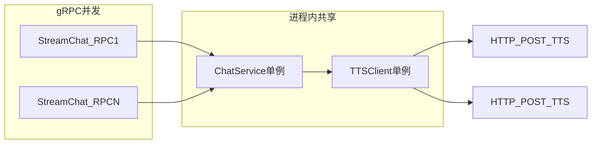

# Xiaozhi 系统架构图

## 系统架构概览（Flat Icon Style）

```
┌─────────────────────────────────────────────────────────────────────────────────────────────────────────────┐
│                                          DEVICE LAYER (设备层)                                              │
├─────────────────────────────────────────────────────────────────────────────────────────────────────────────┤
│                                                                                                               │
│  ┌──────────────────┐         ┌──────────────────┐         ┌──────────────────┐                             │
│  │   🎤 Audio In    │         │   🔊 Audio Out   │         │  📡 WiFi Module  │                             │
│  │   (Microphone)   │         │   (Speaker)      │         │   (Connectivity) │                             │
│  └────────┬─────────┘         └────────▲─────────┘         └────────┬─────────┘                             │
│           │                            │                            │                                       │
│           └────────────────────────────┼────────────────────────────┘                                       │
│                                        │                                                                     │
│                    ┌───────────────────┴───────────────────┐                                                │
│                    │   WebSocket Connection (Opus codec)   │                                                │
│                    └───────────────────┬───────────────────┘                                                │
│                                        │                                                                     │
└────────────────────────────────────────┼─────────────────────────────────────────────────────────────────────┘
                                         │
                                         │ ws://xiaozhi-server:8765
                                         │
┌────────────────────────────────────────▼─────────────────────────────────────────────────────────────────────┐
│                                   GATEWAY LAYER (网关层)                                                     │
│                                  xiaozhi-server (Python)                                                    │
├────────────────────────────────────────────────────────────────────────────────────────────────────────────────┤
│                                                                                                                │
│  ┌──────────────────────────────────────────────────────────────────────────────────────────────────────┐   │
│  │                          WebSocket Server (Port 8765)                                                │   │
│  │  ┌─────────────────────────────────────────────────────────────────────────────────────────────┐    │   │
│  │  │  ConnectionHandler (Per-Session Lifecycle)                                                  │    │   │
│  │  │  ├─ Auth: JWT validation                                                                    │    │   │
│  │  │  ├─ Message Dispatch: textHandle → Handler Registry                                        │    │   │
│  │  │  └─ Session State: user_id, device_id, conversation_id                                     │    │   │
│  │  └─────────────────────────────────────────────────────────────────────────────────────────────┘    │   │
│  │                                                                                                      │   │
│  │  ┌─────────────────────────────────────────────────────────────────────────────────────────────┐    │   │
│  │  │  Message Handlers (Handler Registry)                                                        │    │   │
│  │  │  ├─ helloMessageHandler      → Device handshake & registration                             │    │   │
│  │  │  ├─ listenMessageHandler     → Start/Stop listening (VAD trigger)                          │    │   │
│  │  │  ├─ abortMessageHandler      → Abort TTS/Chat                                              │    │   │
│  │  │  ├─ iotMessageHandler        → IoT device descriptors                                      │    │   │
│  │  │  ├─ mcpMessageHandler        → MCP tool messages                                           │    │   │
│  │  │  ├─ pingMessageHandler       → Keep-alive                                                  │    │   │
│  │  │  └─ serverMessageHandler     → Config reload, restart                                     │    │   │
│  │  └─────────────────────────────────────────────────────────────────────────────────────────────┘    │   │
│  └──────────────────────────────────────────────────────────────────────────────────────────────────────┘   │
│                                                                                                                │
│  ┌──────────────────────────────────────────────────────────────────────────────────────────────────────┐   │
│  │                    Audio Processing Pipeline (Per-Session)                                           │   │
│  │                                                                                                      │   │
│  │  ┌─────────────┐      ┌──────────────┐      ┌──────────────┐      ┌──────────────┐                 │   │
│  │  │   VAD       │      │     ASR      │      │     LLM      │      │     TTS      │                 │   │
│  │  │  (Silero)   │─────▶│  (FunASR/    │─────▶│  (gRPC to    │─────▶│  (IndexTTS   │                 │   │
│  │  │             │      │   Aliyun/    │      │   go-core)   │      │   or others) │                 │   │
│  │  │ Detects     │      │   OpenAI)    │      │              │      │              │                 │   │
│  │  │ speech end  │      │              │      │ Tool calls   │      │ PCM stream   │                 │   │
│  │  │             │      │ Text output  │      │ detected →   │      │ → Opus codec │                 │   │
│  │  └─────────────┘      └──────────────┘      │ Python       │      │ → WebSocket  │                 │   │
│  │                                              │ executes     │      └──────────────┘                 │   │
│  │                                              │ tools        │                                       │   │
│  │                                              └──────────────┘                                       │   │
│  │                                                                                                      │   │
│  │  ┌─────────────────────────────────────────────────────────────────────────────────────────────┐    │   │
│  │  │  Tool Execution (UnifiedToolHandler)                                                        │    │   │
│  │  │  ├─ echo_text, time_now, math_add (native)                                                 │    │   │
│  │  │  ├─ Home Assistant IoT control (hass_* plugins)                                            │    │   │
│  │  │  ├─ RAGFlow knowledge search                                                               │    │   │
│  │  │  ├─ mem0.ai long-term memory                                                               │    │   │
│  │  │  ├─ MCP external tools                                                                     │    │   │
│  │  │  └─ Custom plugins (configurable)                                                          │    │   │
│  │  └─────────────────────────────────────────────────────────────────────────────────────────────┘    │   │
│  └──────────────────────────────────────────────────────────────────────────────────────────────────────┘   │
│                                                                                                                │
│  ┌──────────────────────────────────────────────────────────────────────────────────────────────────────┐   │
│  │                         HTTP Server (Port 8000)                                                      │   │
│  │  ├─ /ota          → OTA endpoint (returns WebSocket URL to device firmware)                         │   │
│  │  └─ /vision       → Vision explain endpoint (image analysis via vLLM)                              │   │
│  └──────────────────────────────────────────────────────────────────────────────────────────────────────┘   │
│                                                                                                                │
└────────────────────────────────────────────────────────────────────────────────────────────────────────────────┘
                                         │
                                         │ gRPC (Port 50051)
                                         │
┌────────────────────────────────────────▼─────────────────────────────────────────────────────────────────────┐
│                                   CORE LAYER (核心层)                                                        │
│                                xiaozhi-go-core (Go/gRPC)                                                    │
├────────────────────────────────────────────────────────────────────────────────────────────────────────────────┤
│                                                                                                                │
│  ┌──────────────────────────────────────────────────────────────────────────────────────────────────────┐   │
│  │                      gRPC Server (Port 50051)                                                        │   │
│  │  ┌─────────────────────────────────────────────────────────────────────────────────────────────┐    │   │
│  │  │  ChatService.StreamChat (Bidirectional Streaming)                                           │    │   │
│  │  │  ├─ Input: ChatRequest (messages[], model, temperature, etc.)                              │    │   │
│  │  │  ├─ Output: ChatResponse stream (TEXT, TOOL_CALL, FINISH events)                           │    │   │
│  │  │  └─ Tool call detection → Python handles execution → Go continues with tool results       │    │   │
│  │  └─────────────────────────────────────────────────────────────────────────────────────────────┘    │   │
│  │                                                                                                      │   │
│  │  ┌─────────────────────────────────────────────────────────────────────────────────────────────┐    │   │
│  │  │  ToolService.ExecuteTool (Native tool execution in Go)                                      │    │   │
│  │  │  ├─ echo_text, time_now, math_add (implemented)                                            │    │   │
│  │  │  └─ Others → TOOL_NOT_IMPLEMENTED_IN_GO (delegated to Python)                              │    │   │
│  │  └─────────────────────────────────────────────────────────────────────────────────────────────┘    │   │
│  └──────────────────────────────────────────────────────────────────────────────────────────────────────┘   │
│                                                                                                                │
│  ┌──────────────────────────────────────────────────────────────────────────────────────────────────────┐   │
│  │                      Internal Architecture                                                           │   │
│  │                                                                                                      │   │
│  │  ┌──────────────────┐  ┌──────────────────┐  ┌──────────────────┐  ┌──────────────────┐           │   │
│  │  │  Config Module   │  │  Logger Module   │  │  Observability   │  │  Interceptors    │           │   │
│  │  │  (config.go)     │  │  (logger.go)     │  │  (request_trace) │  │  (auth, logging) │           │   │
│  │  └──────────────────┘  └──────────────────┘  └──────────────────┘  └──────────────────┘           │   │
│  │                                                                                                      │   │
│  │  ┌──────────────────────────────────────────────────────────────────────────────────────────────┐   │   │
│  │  │  Adapter Layer (LLM & TTS Client Adapters)                                                   │   │   │
│  │  │  ├─ llm_client.go      → Calls external LLM API (Qwen3 via OpenAI-compatible SSE)          │   │   │
│  │  │  └─ tts_client.go      → Calls external TTS service (IndexStreamTTS pool)                  │   │   │
│  │  └──────────────────────────────────────────────────────────────────────────────────────────────┘   │   │
│  │                                                                                                      │   │
│  │  ┌──────────────────────────────────────────────────────────────────────────────────────────────┐   │   │
│  │  │  Service Layer (chat_service.go)                                                             │   │   │
│  │  │  ├─ Message orchestration                                                                    │   │   │
│  │  │  ├─ Tool call detection & routing                                                           │   │   │
│  │  │  └─ Response streaming                                                                      │   │   │
│  │  └──────────────────────────────────────────────────────────────────────────────────────────────┘   │   │
│  │                                                                                                      │   │
│  │  ┌──────────────────────────────────────────────────────────────────────────────────────────────┐   │   │
│  │  │  Metrics & Observability                                                                     │   │   │
│  │  │  ├─ Prometheus metrics (Port 9090)                                                          │   │   │
│  │  │  ├─ Request tracing                                                                         │   │   │
│  │  │  └─ Performance monitoring                                                                  │   │   │
│  │  └──────────────────────────────────────────────────────────────────────────────────────────────┘   │   │
│  └──────────────────────────────────────────────────────────────────────────────────────────────────────┘   │
│                                                                                                                │
└────────────────────────────────────────────────────────────────────────────────────────────────────────────────┘
                                         │
                    ┌────────────────────┼────────────────────┐
                    │                    │                    │
                    ▼                    ▼                    ▼
┌──────────────────────────┐  ┌──────────────────────────┐  ┌──────────────────────────┐
│   EXTERNAL LLM SERVICE   │  │   EXTERNAL TTS SERVICE   │  │  MANAGEMENT CONSOLE API  │
│   (Qwen3 @ kemande.cn)   │  │  (IndexTTS @ kemande.cn) │  │   (Device config, logs)  │
│                          │  │                          │  │                          │
│  OpenAI-compatible SSE   │  │  PCM streaming (gRPC)    │  │  HTTP REST API           │
│  ├─ Model: qwen3         │  │  ├─ Voice: 晓伊          │  │  ├─ Device registration  │
│  ├─ Temperature control  │  │  ├─ Speed control       │  │  ├─ Config management    │
│  └─ Tool definitions     │  │  └─ Emotion control     │  │  └─ ASR/TTS reporting    │
│                          │  │                          │  │                          │
└──────────────────────────┘  └──────────────────────────┘  └──────────────────────────┘
                    │                    │                    │
                    └────────────────────┼────────────────────┘
                                         │
┌────────────────────────────────────────▼─────────────────────────────────────────────────┐
│                          EXTERNAL SERVICES LAYER (外部服务层)                            │
├─────────────────────────────────────────────────────────────────────────────────────────┤
│                                                                                           │
│  ┌──────────────────┐  ┌──────────────────┐  ┌──────────────────┐  ┌──────────────────┐ │
│  │  Home Assistant  │  │   RAGFlow KB     │  │   mem0.ai        │  │  MCP Endpoint    │ │
│  │  (IoT Control)   │  │   (Knowledge)    │  │   (Memory)       │  │  (External Tools)│ │
│  │                  │  │                  │  │                  │  │                  │ │
│  │  hass_* plugins  │  │  Vector search   │  │  Vector storage  │  │  WebSocket       │ │
│  │  Device control  │  │  Context inject  │  │  Long-term mem   │  │  Tool protocol   │ │
│  └──────────────────┘  └──────────────────┘  └──────────────────┘  └──────────────────┘ │
│                                                                                           │
│  ┌──────────────────┐  ┌──────────────────┐  ┌──────────────────┐  ┌──────────────────┐ │
│  │  ASR Providers   │  │  TTS Providers   │  │  LLM Providers   │  │  Other Services  │ │
│  │  (Pluggable)     │  │  (Pluggable)     │  │  (Pluggable)     │  │                  │ │
│  │                  │  │                  │  │                  │  │  Prometheus      │ │
│  │  • FunASR        │  │  • Aliyun        │  │  • OpenAI        │  │  Grafana         │ │
│  │  • Aliyun        │  │  • Doubao        │  │  • Ollama        │  │  Logging         │ │
│  │  • OpenAI        │  │  • Edge TTS      │  │  • Gemini        │  │                  │ │
│  │  • Baidu         │  │  • GPT-SoVITS    │  │  • Coze           │  │                  │ │
│  │  • Tencent       │  │  • FishSpeech    │  │  • Dify           │  │                  │ │
│  │  • Doubao        │  │  • Minimax       │  │  • FastGPT        │  │                  │ │
│  │  • Vosk          │  │  • SiliconFlow   │  │  • Xinference     │  │                  │ │
│  │  • Sherpa-ONNX   │  │  • Tencent       │  │  • Home Assistant │  │                  │ │
│  │  • Local models  │  │  • ttson         │  │  • Ollama         │  │                  │ │
│  │                  │  │  • linker.ai     │  │                  │  │                  │ │
│  │                  │  │  • CozeCN        │  │                  │  │                  │ │
│  │                  │  │  • PaddleSpeech  │  │                  │  │                  │ │
│  └──────────────────┘  └──────────────────┘  └──────────────────┘  └──────────────────┘ │
│                                                                                           │
└───────────────────────────────────────────────────────────────────────────────────────────┘
```

---

## 数据流详解

### 1. 设备连接与认证流程
```
Device
  │
  ├─ WebSocket Connect (ws://xiaozhi-server:8765)
  │
  ├─ Send: {type: "hello", device_id, token, ...}
  │
  ▼
xiaozhi-server (ConnectionHandler)
  │
  ├─ JWT Auth validation
  │
  ├─ Extract: user_id, device_id, conversation_id
  │
  ├─ Register session in memory
  │
  └─ Send: {type: "hello_ack", status: "ok"}
```

### 2. 语音交互完整流程
```
Device (User speaks)
  │
  ├─ Send: {type: "listen", start: true}
  │
  ├─ Stream audio frames (PCM 16kHz)
  │
  ▼
xiaozhi-server (receiveAudioHandle)
  │
  ├─ VAD (Silero) detects speech end
  │
  ├─ Trigger ASR (FunASR/Aliyun/OpenAI)
  │
  ├─ Get: text = "打开客厅灯"
  │
  ▼
xiaozhi-server (chat_via_grpc)
  │
  ├─ Build ChatRequest:
  │  ├─ messages: [{role: "user", content: "打开客厅灯"}]
  │  ├─ model: "qwen3"
  │  ├─ tools: [echo_text, time_now, math_add, hass_turn_on, ...]
  │
  ├─ gRPC StreamChat → xiaozhi-go-core
  │
  ▼
xiaozhi-go-core (ChatService.StreamChat)
  │
  ├─ Call external LLM (Qwen3 @ kemande.cn)
  │
  ├─ LLM response:
  │  ├─ TEXT: "正在打开客厅灯..."
  │  ├─ TOOL_CALL: {name: "hass_turn_on", args: {entity_id: "light.living_room"}}
  │  ├─ FINISH: {finish_reason: "tool_calls"}
  │
  ├─ Stream events back to Python
  │
  ▼
xiaozhi-server (chat_via_grpc receiver)
  │
  ├─ Receive TEXT event → Queue for TTS
  │
  ├─ Receive TOOL_CALL event → Execute tool locally
  │  ├─ Call Home Assistant API
  │  ├─ Get result: {status: "success"}
  │
  ├─ Append tool result to messages[]
  │
  ├─ Call chat_via_grpc again (depth=1) with updated messages
  │
  ▼
xiaozhi-go-core (Second turn)
  │
  ├─ LLM sees tool result
  │
  ├─ Generate final response:
  │  ├─ TEXT: "客厅灯已打开"
  │  ├─ FINISH: {finish_reason: "stop"}
  │
  ▼
xiaozhi-server (sendAudioHandle)
  │
  ├─ Queue text for TTS: "客厅灯已打开"
  │
  ├─ Call TTS service (IndexTTS @ kemande.cn)
  │
  ├─ Get PCM stream
  │
  ├─ Encode to Opus codec
  │
  ├─ Send to device: {type: "audio", data: opus_frames}
  │
  ▼
Device (Speaker plays audio)
```

### 3. 工具执行决策树
```
LLM detects tool_calls
  │
  ├─ Tool: echo_text, time_now, math_add
  │  └─ Go executes natively → Return result immediately
  │
  ├─ Tool: hass_turn_on, hass_get_state, etc.
  │  └─ Python executes (Home Assistant plugin) → Return result
  │
  ├─ Tool: search_from_ragflow
  │  └─ Python executes (RAGFlow plugin) → Return context
  │
  ├─ Tool: mem0_recall, mem0_save
  │  └─ Python executes (mem0.ai plugin) → Return memory
  │
  ├─ Tool: mcp_*
  │  └─ Python executes (MCP plugin) → Call external MCP server
  │
  └─ Tool: custom_*
     └─ Python executes (Custom plugin) → Return result
```

### 4. 配置管理流程
```
xiaozhi-server startup
  │
  ├─ Load config.yaml (local mode)
  │  OR
  ├─ Fetch from manager-api (cloud mode)
  │
  ├─ Parse:
  │  ├─ LLM provider (model, API key, endpoint)
  │  ├─ ASR provider (type, credentials)
  │  ├─ TTS provider (type, voice, speed)
  │  ├─ Tool plugins (enabled/disabled)
  │  ├─ Device whitelist
  │
  ├─ Build gRPC config for go-core
  │
  ├─ Initialize providers (ASR, TTS, VAD)
  │
  └─ Ready to accept connections
```

---

## 区域划分说明

| 区域 | 职责 | 技术栈 |
|------|------|--------|
| **Device Layer** | 音频采集、播放、网络连接 | 嵌入式系统、WebSocket 客户端 |
| **Gateway Layer** | 会话管理、消息路由、音频处理、工具执行 | Python asyncio、WebSocket 服务器 |
| **Core Layer** | LLM 编排、工具检测、流式响应 | Go、gRPC、Protocol Buffers |
| **External Services** | LLM 推理、TTS 合成、知识库、内存、IoT 控制 | 第三方 API、HTTP、WebSocket |

---

## 关键通信协议

| 通信 | 协议 | 方向 | 用途 |
|------|------|------|------|
| Device ↔ Gateway | WebSocket (Opus codec) | 双向 | 实时音频流、消息交互 |
| Gateway ↔ Core | gRPC (Protocol Buffers) | 双向流 | LLM 编排、工具调用 |
| Core ↔ LLM | HTTP (OpenAI-compatible SSE) | 单向 | LLM 推理 |
| Gateway ↔ TTS | gRPC (PCM streaming) | 单向 | 语音合成 |
| Gateway ↔ Management API | HTTP REST | 双向 | 配置、日志上报 |
| Gateway ↔ Home Assistant | HTTP REST | 双向 | IoT 控制 |
| Gateway ↔ RAGFlow | HTTP REST | 双向 | 知识库查询 |
| Gateway ↔ mem0.ai | HTTP REST | 双向 | 长期记忆 |
| Gateway ↔ MCP Server | WebSocket | 双向 | 外部工具协议 |

---

## 消息类型定义

### WebSocket 消息类型（Device ↔ Gateway）
- `hello` - 设备握手
- `listen` - 开始/停止监听
- `audio` - 音频帧
- `abort` - 中止 TTS/聊天
- `ping` - 心跳
- `iot` - IoT 设备描述符
- `mcp` - MCP 工具消息
- `server` - 服务器命令（重启、配置重载）

### gRPC 消息类型（Gateway ↔ Core）
- `ChatRequest` - 聊天请求（消息、模型、工具定义）
- `ChatResponse` - 聊天响应流（TEXT、TOOL_CALL、FINISH 事件）
- `ExecuteToolRequest` - 工具执行请求
- `ExecuteToolResponse` - 工具执行响应

---

## 性能特性

- **流式处理**：音频、LLM 响应、TTS 输出均采用流式处理，降低延迟
- **有界队列**：ASR/TTS/Report 队列有界化 + 背压策略，防止内存溢出
- **并发处理**：Python asyncio 支持多会话并发，Go gRPC 支持多连接
- **工具执行**：Python 本地执行大多数工具，Go 仅执行简单工具，减少跨进程开销
- **可观测性**：Prometheus 指标、请求追踪、结构化日志

---

## xiaozhi-go-core：并发场景下的 TTS 请求

本节描述 [`main/xiaozhi-go-core`](main/xiaozhi-go-core) 在多个 gRPC `StreamChat` 并发时，如何通过 [`internal/adapter/tts_client.go`](main/xiaozhi-go-core/internal/adapter/tts_client.go) 的 HTTP 客户端调用 xiaozhi-server 侧 IndexStream 风格 TTS（与上层 gRPC 元数据中的 `tts_config` 配合）。

### 调用链与组件

- **入口**：[`internal/server/grpc_server.go`](main/xiaozhi-go-core/internal/server/grpc_server.go) 的 `StreamChat` → [`ChatService.StreamChat`](main/xiaozhi-go-core/internal/service/chat_service.go)。
- **HTTP 合成**：[`TTSClient.Synthesize`](main/xiaozhi-go-core/internal/adapter/tts_client.go)（`POST` JSON `{"text","character"}`，流式读取 16-bit LE PCM 后按帧切分）。



### 跨 RPC（多路并发会话）

| 行为 | 说明 |
|------|------|
| 实例共享 | `NewChatService` 只创建一个 `TTSClient`，所有并发 RPC 共用同一 `*http.Client`（标准库约定下可并发复用）。 |
| 聊天级限流 | `StreamChat` 使用 `inflight` 原子计数；超过 `server.max_concurrency`（默认 100）时返回 `CHAT_OVERLOADED`，**不会**再发起 TTS。 |
| 多后端选路 | `pickService` 在 `preferIndex == -1` 时用进程内全局 `atomic.Uint64` 对 `tts.services` 中可用条目做轮询，多请求交错调用时会交错命中各后端。 |
| TTS 专用全局限流 | **无**；在 `max_concurrency` 允许范围内，进行中 `Synthesize` 数量可随会话与 flush 次数上升，直至 HTTP/系统资源成为瓶颈。 |

### 单次 StreamChat 内（分段并行）

1. LLM 流式 `CONTENT_CHUNK` 写入缓冲区，满足 [`flushTTSBuffer`](main/xiaozhi-go-core/internal/service/chat_service.go) 条件后调用 [`emitAudioChunks`](main/xiaozhi-go-core/internal/service/chat_service.go)。
2. 文本按 `tts.segment_max_chars`（默认 80）拆成多段。
3. **并行度**：以 `tts.max_parallel`（默认 4）为基准；若 gRPC 元数据 `tts_config.streams` 为正且**小于**该值，则降为 `streams`（元数据中 `streams` 缺省或非法时会被解析为 2）。即实现为「在不超过 `max_parallel` 的前提下，用更小的 `streams` 收紧并发」。
4. 每段一个 goroutine，通过带缓冲 channel 作为信号量，限制**该次 flush** 内同时进行的 `Synthesize` 数。
5. 各段共享该次 `StreamChat` 的请求级 `context`（含超时）；`wg.Wait()` 后按 `segIdx` 排序再发送 `AUDIO_CHUNK`，保证输出顺序与分段顺序一致。`tts_stream_id` 形如 `stream-{segIdx % maxParallel}`。

### 与网关文档中「Gateway ↔ TTS」表述的关系

设备侧语音合成仍可能由 Python 网关直连 TTS；当网关把 TTS 交给 go-core 时，go-core 走的是 **HTTP 到配置的 TTS URL**，而非表格「Gateway ↔ Core」行的 gRPC。上表「关键通信协议」中以具体部署为准。

